  
  

---

# 💻 Tech Stack:

    <h2>💻 Tech Stack</h2>
    <a href="https://developer.mozilla.org/en-US/docs/Web/HTML" target="_blank"><picture>
        <source media="(prefers-color-scheme: dark)" srcset="https://cdn.simpleicons.org/html5/ffffff">
        <source media="(prefers-color-scheme: light)" srcset="https://cdn.simpleicons.org/html5/000000">
        
    </picture></a>&nbsp;
    <a href="https://developer.mozilla.org/en-US/docs/Web/CSS" target="_blank"><picture>
        <source media="(prefers-color-scheme: dark)" srcset="https://cdn.simpleicons.org/css/ffffff">
        <source media="(prefers-color-scheme: light)" srcset="https://cdn.simpleicons.org/css/000000">
        
    </picture></a>&nbsp;
    <a href="https://developer.mozilla.org/en-US/docs/Web/JavaScript" target="_blank"><picture>
        <source media="(prefers-color-scheme: dark)" srcset="https://cdn.simpleicons.org/javascript/ffffff">
        <source media="(prefers-color-scheme: light)" srcset="https://cdn.simpleicons.org/javascript/000000">
        
    </picture></a>&nbsp;
    <a href="https://www.typescriptlang.org/" target="_blank"><picture>
        <source media="(prefers-color-scheme: dark)" srcset="https://cdn.simpleicons.org/typescript/ffffff">
        <source media="(prefers-color-scheme: light)" srcset="https://cdn.simpleicons.org/typescript/000000">
        
    </picture></a>&nbsp;
    <a href="https://react.dev/" target="_blank"><picture>
        <source media="(prefers-color-scheme: dark)" srcset="https://cdn.simpleicons.org/react/ffffff">
        <source media="(prefers-color-scheme: light)" srcset="https://cdn.simpleicons.org/react/000000">
        
    </picture></a>&nbsp;
    <a href="https://nextjs.org/" target="_blank"><picture>
        <source media="(prefers-color-scheme: dark)" srcset="https://cdn.simpleicons.org/nextdotjs/ffffff">
        <source media="(prefers-color-scheme: light)" srcset="https://cdn.simpleicons.org/nextdotjs/000000">
        
    </picture></a>&nbsp;
    <a href="https://vuejs.org/" target="_blank"><picture>
        <source media="(prefers-color-scheme: dark)" srcset="https://cdn.simpleicons.org/vuedotjs/ffffff">
        <source media="(prefers-color-scheme: light)" srcset="https://cdn.simpleicons.org/vuedotjs/000000">
        
    </picture></a>&nbsp;
    <a href="https://nuxt.com/" target="_blank"><picture>
        <source media="(prefers-color-scheme: dark)" srcset="https://cdn.simpleicons.org/nuxt/ffffff">
        <source media="(prefers-color-scheme: light)" srcset="https://cdn.simpleicons.org/nuxt/000000">
        
    </picture></a>&nbsp;
    <a href="https://svelte.dev/" target="_blank"><picture>
        <source media="(prefers-color-scheme: dark)" srcset="https://cdn.simpleicons.org/svelte/ffffff">
        <source media="(prefers-color-scheme: light)" srcset="https://cdn.simpleicons.org/svelte/000000">
        
    </picture></a>&nbsp;
    <a href="https://astro.build/" target="_blank"><picture>
        <source media="(prefers-color-scheme: dark)" srcset="https://cdn.simpleicons.org/astro/ffffff">
        <source media="(prefers-color-scheme: light)" srcset="https://cdn.simpleicons.org/astro/000000">
        
    </picture></a>&nbsp;
    <a href="https://tailwindcss.com/" target="_blank"><picture>
        <source media="(prefers-color-scheme: dark)" srcset="https://cdn.simpleicons.org/tailwindcss/ffffff">
        <source media="(prefers-color-scheme: light)" srcset="https://cdn.simpleicons.org/tailwindcss/000000">
        
    </picture></a>&nbsp;
    <a href="https://vite.dev/" target="_blank"><picture>
        <source media="(prefers-color-scheme: dark)" srcset="https://cdn.simpleicons.org/vite/ffffff">
        <source media="(prefers-color-scheme: light)" srcset="https://cdn.simpleicons.org/vite/000000">
        
    </picture></a>&nbsp;
    <a href="https://www.figma.com/" target="_blank"><picture>
        <source media="(prefers-color-scheme: dark)" srcset="https://cdn.simpleicons.org/figma/ffffff">
        <source media="(prefers-color-scheme: light)" srcset="https://cdn.simpleicons.org/figma/000000">
        
    </picture></a>&nbsp;
    <a href="https://wordpress.org/" target="_blank"><picture>
        <source media="(prefers-color-scheme: dark)" srcset="https://cdn.simpleicons.org/wordpress/ffffff">
        <source media="(prefers-color-scheme: light)" srcset="https://cdn.simpleicons.org/wordpress/000000">
        
    </picture></a>&nbsp;
    <a href="https://nodejs.org/" target="_blank"><picture>
        <source media="(prefers-color-scheme: dark)" srcset="https://cdn.simpleicons.org/nodedotjs/ffffff">
        <source media="(prefers-color-scheme: light)" srcset="https://cdn.simpleicons.org/nodedotjs/000000">
        
    </picture></a>&nbsp;
    <a href="https://bun.sh" target="_blank"><picture>
        <source media="(prefers-color-scheme: dark)" srcset="https://cdn.simpleicons.org/bun/ffffff">
        <source media="(prefers-color-scheme: light)" srcset="https://cdn.simpleicons.org/bun/000000">
        
    </picture></a>&nbsp;
    <a href="https://expressjs.com/" target="_blank"><picture>
        <source media="(prefers-color-scheme: dark)" srcset="https://cdn.simpleicons.org/express/ffffff">
        <source media="(prefers-color-scheme: light)" srcset="https://cdn.simpleicons.org/express/000000">
        
    </picture></a>&nbsp;
    <a href="https://nestjs.com/" target="_blank"><picture>
        <source media="(prefers-color-scheme: dark)" srcset="https://cdn.simpleicons.org/nestjs/ffffff">
        <source media="(prefers-color-scheme: light)" srcset="https://cdn.simpleicons.org/nestjs/000000">
        
    </picture></a>&nbsp;
    <a href="https://www.php.net/" target="_blank"><picture>
        <source media="(prefers-color-scheme: dark)" srcset="https://cdn.simpleicons.org/php/ffffff">
        <source media="(prefers-color-scheme: light)" srcset="https://cdn.simpleicons.org/php/000000">
        
    </picture></a>&nbsp;
    <a href="https://laravel.com/" target="_blank"><picture>
        <source media="(prefers-color-scheme: dark)" srcset="https://cdn.simpleicons.org/laravel/ffffff">
        <source media="(prefers-color-scheme: light)" srcset="https://cdn.simpleicons.org/laravel/000000">
        
    </picture></a>&nbsp;
    <a href="https://www.python.org/" target="_blank"><picture>
        <source media="(prefers-color-scheme: dark)" srcset="https://cdn.simpleicons.org/python/ffffff">
        <source media="(prefers-color-scheme: light)" srcset="https://cdn.simpleicons.org/python/000000">
        
    </picture></a>&nbsp;
    <a href="https://www.djangoproject.com/" target="_blank"><picture>
        <source media="(prefers-color-scheme: dark)" srcset="https://cdn.simpleicons.org/django/ffffff">
        <source media="(prefers-color-scheme: light)" srcset="https://cdn.simpleicons.org/django/000000">
        
    </picture></a>&nbsp;
    <a href="https://fastapi.tiangolo.com/" target="_blank"><picture>
        <source media="(prefers-color-scheme: dark)" srcset="https://cdn.simpleicons.org/fastapi/ffffff">
        <source media="(prefers-color-scheme: light)" srcset="https://cdn.simpleicons.org/fastapi/000000">
        
    </picture></a>&nbsp;
    <a href="https://go.dev/" target="_blank"><picture>
        <source media="(prefers-color-scheme: dark)" srcset="https://cdn.simpleicons.org/go/ffffff">
        <source media="(prefers-color-scheme: light)" srcset="https://cdn.simpleicons.org/go/000000">
        
    </picture></a>&nbsp;
    <a href="https://www.java.com/" target="_blank"><picture>
        <source media="(prefers-color-scheme: dark)" srcset="https://cdn.simpleicons.org/openjdk/ffffff">
        <source media="(prefers-color-scheme: light)" srcset="https://cdn.simpleicons.org/openjdk/000000">
        
    </picture></a>&nbsp;
    <a href="https://www.rust-lang.org/" target="_blank"><picture>
        <source media="(prefers-color-scheme: dark)" srcset="https://cdn.simpleicons.org/rust/ffffff">
        <source media="(prefers-color-scheme: light)" srcset="https://cdn.simpleicons.org/rust/000000">
        
    </picture></a>&nbsp;
    <a href="https://www.gnu.org/software/bash/" target="_blank"><picture>
        <source media="(prefers-color-scheme: dark)" srcset="https://cdn.simpleicons.org/gnubash/ffffff">
        <source media="(prefers-color-scheme: light)" srcset="https://cdn.simpleicons.org/gnubash/000000">
        
    </picture></a>&nbsp;
    <a href="https://www.postgresql.org/" target="_blank"><picture>
        <source media="(prefers-color-scheme: dark)" srcset="https://cdn.simpleicons.org/postgresql/ffffff">
        <source media="(prefers-color-scheme: light)" srcset="https://cdn.simpleicons.org/postgresql/000000">
        
    </picture></a>&nbsp;
    <a href="https://www.mysql.com/" target="_blank"><picture>
        <source media="(prefers-color-scheme: dark)" srcset="https://cdn.simpleicons.org/mysql/ffffff">
        <source media="(prefers-color-scheme: light)" srcset="https://cdn.simpleicons.org/mysql/000000">
        
    </picture></a>&nbsp;
    <a href="https://www.mongodb.com/" target="_blank"><picture>
        <source media="(prefers-color-scheme: dark)" srcset="https://cdn.simpleicons.org/mongodb/ffffff">
        <source media="(prefers-color-scheme: light)" srcset="https://cdn.simpleicons.org/mongodb/000000">
        
    </picture></a>&nbsp;
    <a href="https://redis.io/" target="_blank"><picture>
        <source media="(prefers-color-scheme: dark)" srcset="https://cdn.simpleicons.org/redis/ffffff">
        <source media="(prefers-color-scheme: light)" srcset="https://cdn.simpleicons.org/redis/000000">
        
    </picture></a>&nbsp;
    <a href="https://supabase.com/" target="_blank"><picture>
        <source media="(prefers-color-scheme: dark)" srcset="https://cdn.simpleicons.org/supabase/ffffff">
        <source media="(prefers-color-scheme: light)" srcset="https://cdn.simpleicons.org/supabase/000000">
        
    </picture></a>&nbsp;
    <a href="https://firebase.google.com/" target="_blank"><picture>
        <source media="(prefers-color-scheme: dark)" srcset="https://cdn.simpleicons.org/firebase/ffffff">
        <source media="(prefers-color-scheme: light)" srcset="https://cdn.simpleicons.org/firebase/000000">
        
    </picture></a>&nbsp;
    <a href="https://www.prisma.io/" target="_blank"><picture>
        <source media="(prefers-color-scheme: dark)" srcset="https://cdn.simpleicons.org/prisma/ffffff">
        <source media="(prefers-color-scheme: light)" srcset="https://cdn.simpleicons.org/prisma/000000">
        
    </picture></a>&nbsp;
    <a href="https://www.docker.com/" target="_blank"><picture>
        <source media="(prefers-color-scheme: dark)" srcset="https://cdn.simpleicons.org/docker/ffffff">
        <source media="(prefers-color-scheme: light)" srcset="https://cdn.simpleicons.org/docker/000000">
        
    </picture></a>&nbsp;
    <a href="https://www.cloudflare.com/" target="_blank"><picture>
        <source media="(prefers-color-scheme: dark)" srcset="https://cdn.simpleicons.org/cloudflare/ffffff">
        <source media="(prefers-color-scheme: light)" srcset="https://cdn.simpleicons.org/cloudflare/000000">
        
    </picture></a>&nbsp;
    <a href="https://vercel.com/" target="_blank"><picture>
        <source media="(prefers-color-scheme: dark)" srcset="https://cdn.simpleicons.org/vercel/ffffff">
        <source media="(prefers-color-scheme: light)" srcset="https://cdn.simpleicons.org/vercel/000000">
        
    </picture></a>&nbsp;
    <a href="https://www.netlify.com/" target="_blank"><picture>
        <source media="(prefers-color-scheme: dark)" srcset="https://cdn.simpleicons.org/netlify/ffffff">
        <source media="(prefers-color-scheme: light)" srcset="https://cdn.simpleicons.org/netlify/000000">
        
    </picture></a>&nbsp;
    <a href="https://github.com/" target="_blank"><picture>
        <source media="(prefers-color-scheme: dark)" srcset="https://cdn.simpleicons.org/github/ffffff">
        <source media="(prefers-color-scheme: light)" srcset="https://cdn.simpleicons.org/github/000000">
        
    </picture></a>&nbsp;

---

    <h2>💻 Profile Stats</h2>
    
     
    

---

    <h2>📊 GitHub Stats</h2>
    
     
    
     
    

    <h3>👀 Visitor Counter</h3>
    

