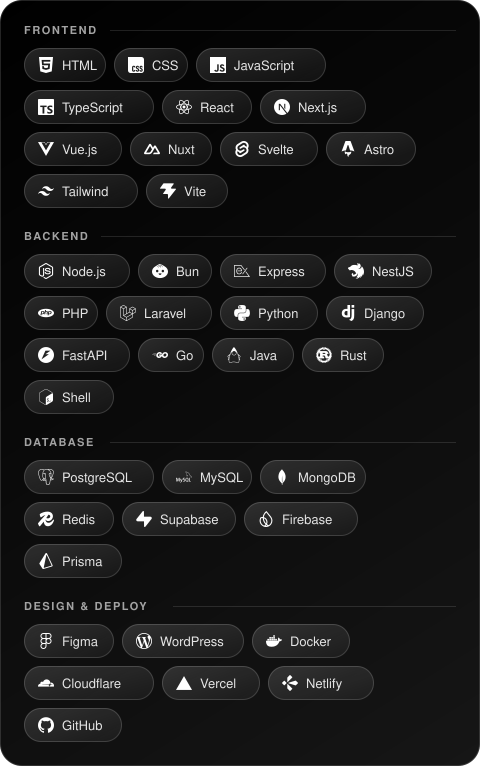

  
  

---

    <h2>💻 Tech Stack</h2>
    

---

    <h2>💻 Profile Stats</h2>
    
     
    

---

    <h2>📊 GitHub Stats</h2>
    
     
    
     
    

---

    <h2>👀 Visitor Counter</h2>
    

